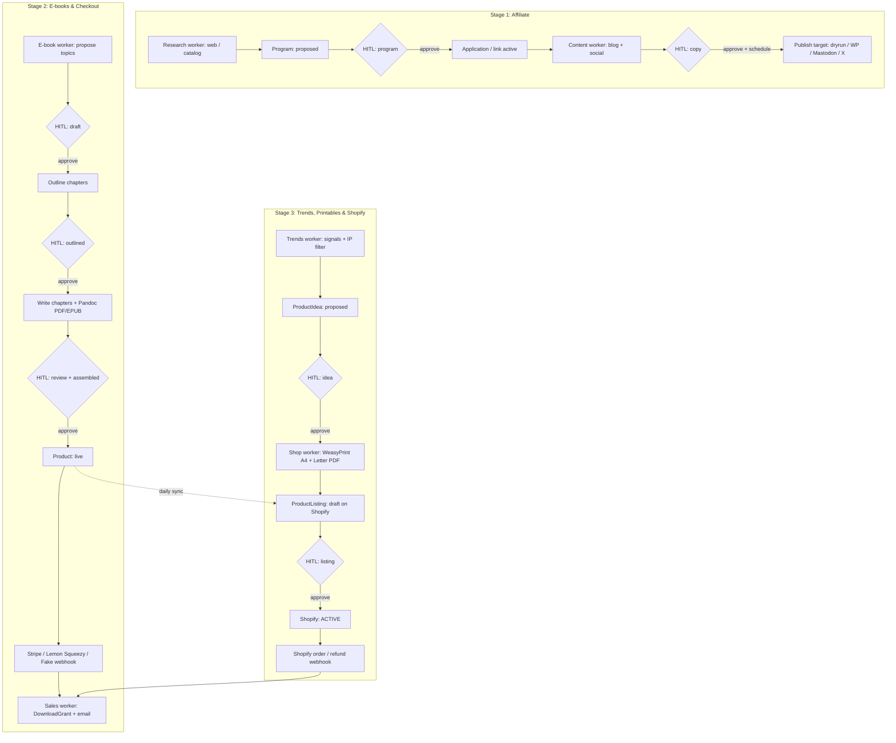
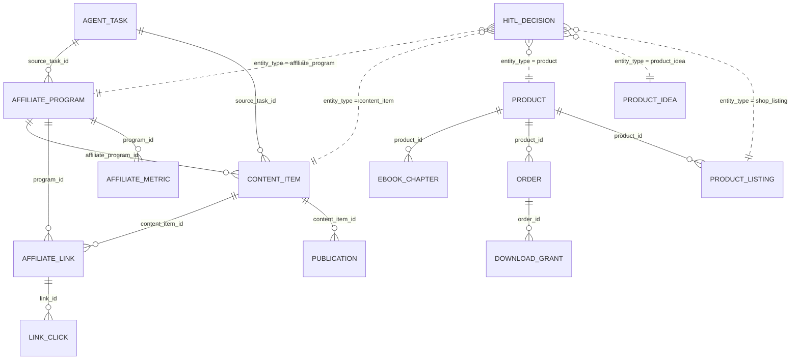
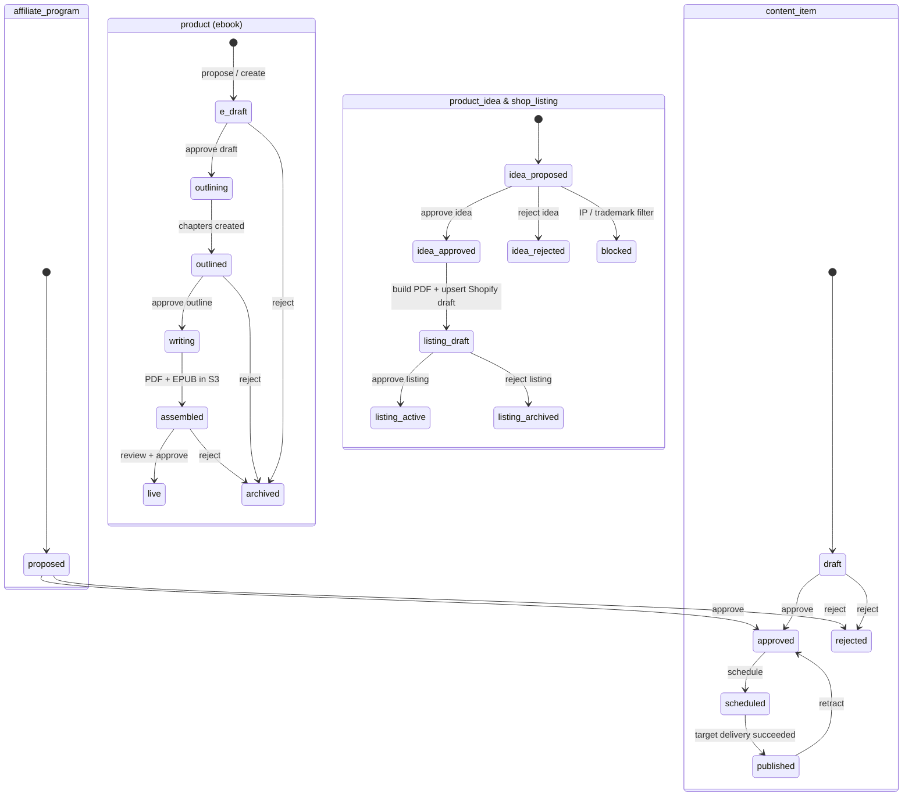
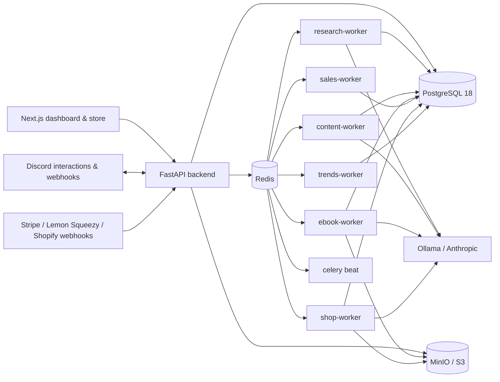
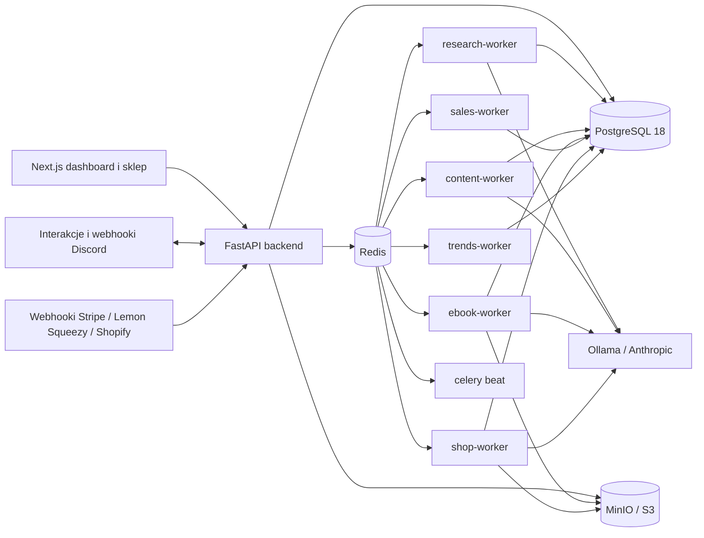

[English](#english) · [Polski](#polski)

<a id="english"></a>

# Autonomous AI Revenue System

A system in which agents propose affiliate programs, articles, e-books, and digital store products, and a human releases only what they have approved themselves.

The business goal is repeatable revenue across three streams built on one skeleton: affiliate marketing (high-ticket and SaaS with recurring commission), e-books with direct checkout, and a digital store (printables and e-books listed on Shopify). This repository delivers all three streams on shared queues, shared state tables, and a single human-in-the-loop (HITL) log. The operator's target ($40–50k per month from affiliate alone, with digital products layered on top) is a product hypothesis. It is not a result of this code.

## Problem

Running affiliate content, self-published e-books, and a digital storefront by hand splits into jobs that do not scale together:

1. Find affiliate programs worth promoting, track applications, and keep tracking links alive after publication.
2. Write blog reviews and social posts, attach attributed links, and publish on a schedule rather than in a burst.
3. Turn recurring reader problems into structured e-books and printable templates without spending model budget on topics nobody approved.
4. Run checkout, signed file delivery, refunds, and Shopify listings while making sure no unreviewed text, broken asset, or trademarked term goes live on its own.

One person can do each of these once. They cannot run all three every week and still guarantee that an agent never publishes or lists a product without a human decision on record.

## Context

The problem belongs to the operator of a single niche publication and digital catalog about software and workflows for small businesses. It does not belong to an affiliate network, a publishing house, or a brand with an editorial team.

The stakes are specific to that operator:

- **Recurring commission** (SaaS) is worth more than a one-off payout, because the same referred customer pays every month.
- **High-ticket** raises the payout per conversion, so a small amount of traffic can still make sense.
- **Own digital products** (e-books and printables) turn existing topical authority into direct margin without waiting on affiliate approval windows.
- **A bad publish costs more than no publish.** A weak recommendation burns reader trust, an undisclosed affiliate link violates rules for material connections ([FTC Endorsement Guides](https://www.ftc.gov/business-guidance/resources/ftcs-endorsement-guides-what-people-are-asking)), an unreviewed e-book wastes token budget and triggers refunds, and a scraping-driven printable can hit a third-party trademark.

That is why the product does not start from "an agent that publishes by itself." It starts from agents that prepare decisions and artifacts, and from a human who records every release.

## Solution

The repository implements the three stages from [docs/requirements_architecture.md](docs/requirements_architecture.md) as independent workers sharing one control loop:

### Stage 1: Affiliate marketing

1. **Research** (`research-worker`) discovers candidate programs either from the web (`RESEARCH_SOURCE=web`: search query → `robots.txt`-polite fetch → structured fact extraction → weighted score) or from a sample catalog (`RESEARCH_SOURCE=catalog`). Known names and domains (including programs within a 180-day decline cooldown) are skipped. New rows land as `proposed`.
2. **A human** approves or rejects the program in the dashboard or via an interactive Discord card. The decision is stored in `hitl_decisions`, and a Slack/Discord webhook receives a notice.
3. **A human** tracks the network application (`not_applied → pending → active / declined`) and either activates a supported network (`awin`, `impact`, `cj`, `amazon`) or pastes a manual affiliate link. The agent never guesses tracking credentials.
4. **Content** (`content-worker`) writes a blog draft and a social draft for `approved` programs that can be linked (`active` on a network or holding a pasted link) and do not yet have content. Each item receives its own attributed `affiliate_links` row (`subid = content_item.id`) routed through `/go/{slug}` (or a direct tagged URL with an Amazon-specific disclosure when `network = amazon`).
5. **A human** approves the copy and sets `scheduled_for`. Every 15 minutes `beat` delivers due items within the configured publishing window (`PUBLISH_WINDOW_HOURS`) to the target adapter (`dryrun`, `wordpress`, `mastodon`, `x`) and records each attempt in `publications`.
6. **Scheduled maintenance** syncs daily conversion and revenue metrics from affiliate networks (`affiliate_metrics`), recomputes Bayesian-smoothed EPC to rescore proposed programs, flags pending applications older than 14 days, and probes active links for dead destinations or 30-day click silence.

### Stage 2: E-books and direct sales

1. **Topic proposal** (`ebook-worker`) proposes book titles and angles for a niche using approved affiliate programs as context. Each proposal is saved as a `Product` (`kind = ebook`, `status = draft`).
2. **Three HITL gates** separate topic selection, structure, and final release:
   - Approving a `draft` product queues `ebook.outline`, generating up to `EBOOK_MAX_CHAPTERS` structured chapters (`ebook_chapters`) and moving the product to `outlined`.
   - Approving an `outlined` product queues `ebook.write`. The worker writes chapters sequentially, commits after every chapter, passes a recap of earlier chapters to avoid repetition, enforces `EBOOK_MAX_TOKENS_PER_BOOK`, and queues `ebook.assemble` once all chapters succeed. Assembly compiles Markdown into PDF and EPUB via Pandoc and Typst, validates page count and size, uploads assets to S3/MinIO, and sets `assembled`.
   - Approving an `assembled` product requires a recorded human review (`POST /products/{id}/review` when `EBOOK_MIN_HUMAN_REVIEW=1`) before the status becomes `live`.
3. **Storefront and fulfillment** (`sales-worker`): `live` products appear on the public catalog (`/store`, `/p/{slug}`) with a table of contents and first-chapter sample. Checkout creates an `Order` (`pending`) and redirects to the configured payment provider (`fake`, `stripe`, or `lemonsqueezy`). Signed webhooks record `payment_events` and queue `sales.fulfill` or `sales.refund`: fulfillment verifies net amount against the order, creates a time- and count-limited `DownloadGrant` (`/download/{token}`), and sends a delivery email (`console` or `resend`); refunds mark the order `refunded` and revoke its download grants.

### Stage 3: Digital store — trends, printables, and Shopify

1. **Trend collection and scoring** (`trends-worker`) collects demand signals (`trend_signals`) from configured sources (`own` content clicks, web `search`, fulfilled `orders`, Google Search Console) and proposes printable product ideas (`product_ideas`). Terms matching third-party trademarks or brand blocklists are stored as `blocked` with a reason; the rest receive a weighted score and land as `proposed`.
2. **Two HITL gates** separate building the asset from publishing the store listing:
   - Approving a `proposed` idea queues `shop.build` (`shop-worker`), which generates a structured multi-page printable specification, renders both A4 and Letter PDFs via WeasyPrint, validates them, uploads them to S3/MinIO, and creates a `DRAFT` listing on Shopify (`product_listings`). Daily sync (`shop.sync_ebooks`) also creates `DRAFT` Shopify listings for `live` e-books.
   - Approving a `draft` listing queues `shop.activate`, which switches the product to `ACTIVE` on Shopify and publishes it to the store channel.
3. **Shopify fulfillment**: `orders/paid` and `refunds/create` webhooks (`/webhooks/shopify/...`) verify the Shopify HMAC, deduplicate via `payment_events`, and queue `shop.fulfill` or `shop.refund`, reusing the same `orders`, `download_grants`, and email delivery pipeline as direct sales.



## Data model

Seventeen tables capture what agents proposed, what humans decided, what went out to external channels, and what customers bought.

| Table | What it is for |
|---|---|
| `agent_tasks` | Work queue log: task type, status, input, output, error, timestamps. |
| `hitl_decisions` | Polymorphic judgment log: `entity_type`, `entity_id`, `decision`, `actor`, `comment`, timestamp. |
| `hitl_discord_messages` | Maps a proposed entity (`affiliate_program`, `product_idea`, `shop_listing`) to its interactive Discord message ID for in-place card updates. |
| `affiliate_programs` | Program, URL, network, category, rationale, weighted `score`, `status`, `application_status`, link, and commercial facts in `extras`. |
| `affiliate_links` | Per-content tracked links: `slug` (`/go/{slug}`), `subid`, `destination_url`, `tracking_url`, `network`, health `status`. |
| `link_clicks` | Click log for `/go/{slug}`: timestamp, referer, truncated user-agent SHA-256 hash, country header. |
| `affiliate_metrics` | Daily network performance (`clicks`, pending/approved/declined conversions, pending/approved revenue in cents) keyed by `(network, subid, day)`. |
| `content_items` | Generated copy, channel (`blog` / `social`), `status`, `scheduled_for`, `published_at`, link to `affiliate_programs`. |
| `publications` | Delivery log per `(content_item_id, target)`: `status` (`in_flight`, `succeeded`, `failed`, `needs_review`, `retracted`), `attempts`, `external_id`, `external_url`. |
| `products` | Sellable digital goods (`kind` = `ebook` or `printable`), `slug`, `price_cents`, `status`, S3 keys (`asset_pdf`, `asset_epub`), review metadata in `extras`. |
| `ebook_chapters` | Chapter position, title, brief, Markdown `body`, `tokens_used`, and per-chapter status (`pending`, `written`, `failed`). |
| `orders` | Customer orders across `fake`, `stripe`, `lemonsqueezy`, and `shopify`: `provider_session_id`, `provider_payment_id`, `amount_cents`, `source` (SubID attribution), `status`. |
| `payment_events` | Idempotency log of verified incoming payment and Shopify webhooks (`provider`, `event_id`, `payload`, `processed_at`). |
| `download_grants` | Signed SHA-256 token hashes (`token_hash`), `expires_at`, `max_downloads`, `download_count`, `revoked` flag. |
| `trend_signals` | Raw demand signals (`source`, `term`, `value`, `meta`, `captured_at`). |
| `product_ideas` | Scored printable candidates (`term`, `title`, `score`, `score_breakdown`, `status`, `blocked_reason`). |
| `product_listings` | Store listings on `shopify` / `fake`: `external_id`, `external_variant_id`, `handle`, `price_cents`, `status`. |

`hitl_decisions` has no foreign key to a single table. `entity_type` + `entity_id` cover affiliate programs, content items, e-books, product ideas, and shop listings alike. Adding a gate never requires a second decision table.



Statuses are state machines enforced by the API (invalid transitions return `409 Conflict`):



## Architecture

The API accepts a command or webhook, records state in Postgres, and dispatches work to a named Celery queue by string task name. The backend never imports agent worker packages. Each agent runs in its own container image with its own dependencies (for example, Pandoc and Typst exist only in `ebook-worker`, and WeasyPrint exists only in `shop-worker`).



The shared contract lives in the `revenue_swarm` package (`shared/`): SQLAlchemy models, enums, the LLM wrapper (`ChatOllama` and optional `ChatAnthropic`), S3 storage helpers, affiliate network adapters (`awin`, `impact`, `cj`, `simple`), payment providers (`fake`, `stripe`, `lemonsqueezy`), email delivery (`console`, `resend`), PDF rendering (`WeasyPrint` + `pypdf`), fulfillment grants, and Celery task/queue names. Alembic stays with `backend/` so schema migrations have a single owner.

| Directory | Role |
|---|---|
| `shared/` | Shared library (`revenue_swarm`) used by the backend and all agent workers. |
| `backend/` | FastAPI HTTP contract, HITL state transitions, Discord bot & webhook notifications, `/go/{slug}` redirect, payment & Shopify webhooks, Alembic migrations. |
| `agents/research/` | Web and catalog program discovery, `robots.txt`-polite fetching, structured fact extraction, network performance sync, EPC smoothing, link health probing. |
| `agents/content/` | Blog and social draft generation, per-item SubID link injection, scheduled publishing to `dryrun`, WordPress, Mastodon, and X, plus retraction. |
| `agents/ebook/` | Niche topic proposal, chapter outlining, token-budgeted chapter writing, Markdown-to-PDF/EPUB assembly via Pandoc and Typst. |
| `agents/sales/` | Idempotent payment webhook fulfillment, net amount verification, signed download grant issuance, delivery email, and refund revocation. |
| `agents/shop/` | Printable specification generation, A4 & Letter PDF rendering via WeasyPrint, Shopify Admin GraphQL listing management, Shopify order/refund fulfillment. |
| `agents/trends/` | Demand signal collection (own clicks, search, orders, GSC), trademark/IP risk filtering, and printable idea scoring. |
| `frontend/` | Operator HITL dashboard (`/`, `/shop`) and public digital storefront (`/store`, `/p/[slug]`, `/download/[token]`, `/legal/*`). |

## Decisions

| Choice | Reason |
|---|---|
| Separate HITL gates per risk | Approving an affiliate offer is not approving copy; approving a book topic is not approving a 12-chapter token spend or the assembled PDF; approving a printable idea is not activating a live Shopify listing. Every gate checks a distinct failure mode. |
| Web discovery + sample catalog behind one switch (`RESEARCH_SOURCE`) | Local runs and CI use `SEARCH_STUB=1` or `RESEARCH_SOURCE=catalog` (`example-*.test`) without network keys. Switching `RESEARCH_SOURCE=web` enables search, `robots.txt`-checked fetching, structured LLM extraction (`ProgramFacts`), and weighted scoring. |
| Bayesian-smoothed EPC with priority (`own → operator → declared`) | Early programs have zero or few clicks; raw `revenue / clicks` on 2 clicks is noise. Once clicks reach `MIN_CLICKS_FOR_EPC`, `smoothed_epc` blends measured performance with a category prior (`EPC_PRIOR_WEIGHT`) and rescores proposed programs. |
| `/go/{slug}` 302 redirect with per-item SubID, except Amazon | A `302` redirect lets the operator repair a broken destination URL in one place without editing already-published blog posts, while logging clicks and attributing conversions via `subid = content_item.id`. Amazon Associates forbids cloaking/redirecting links, so `network = amazon` automatically sets `allow_redirect = false`, embeds the direct tagged URL, and uses the required Amazon disclosure sentence. |
| `publications` reservation table before calling external APIs | External CMS and social APIs can time out after creating a post. Reserving an `in_flight` row per `(content_item_id, target)` and moving ambiguous timeouts to `needs_review` prevents duplicate posts on retry. |
| Three gates and per-chapter commits for e-books | Writing a full book in one task loses everything on a timeout and burns tokens on a bad outline. Committing each `EbookChapter` separately with `EBOOK_MAX_TOKENS_PER_BOOK` lets `retry-chapters` re-run only failed chapters. |
| Signed `download_grants` instead of public S3 links | Customers receive `/download/{token}` (stored only as a SHA-256 hash in Postgres). The backend checks expiry, download count (`DOWNLOAD_MAX_PER_GRANT`), and `revoked` status before streaming or issuing a short-lived presigned URL, so a refund immediately cuts off access. |
| Shared fulfillment across Stripe, Lemon Squeezy, and Shopify | Whether a customer buys an e-book on the native storefront or a printable/e-book on Shopify, the webhook lands in `payment_events` and produces the same `Order` and `DownloadGrant` records. |
| IP filter before human review in `trends-worker` | Automatically blocking search terms that match known trademarks or brand patterns (`IdeaStatus.BLOCKED`) keeps obvious infringement out of the HITL queue before any PDF is rendered. |
| Interactive Discord cards alongside the web dashboard | The operator can approve or reject proposed programs, product ideas, and shop listings directly from Discord buttons (`POST /discord/interactions` verified with Ed25519 and restricted to `DISCORD_ALLOWED_USER_IDS`), while the database remains the single source of truth and edits the card after the decision. |
| Safe defaults (`LLM_STUB=1`, `SEARCH_STUB=1`, `PUBLISH_ENABLED=0`, `PAYMENT_PROVIDER=fake`, `SHOP_PLATFORM=fake`) | The entire multi-agent system boots and passes integration tests offline without API keys, model downloads, or live store credentials. Every external integration is an explicit environment switch. |

## Four roles in this repository

**Business analyst.** The product requirement "autonomous revenue agents" is decomposed into explicit unit-economics and compliance rules across three streams: recurring or high-ticket affiliate offers with FTC-compliant disclosures, token-capped e-books reviewed by a human before sale, and trademark-filtered printables listed as drafts before activation. Metrics that do not exist at cold start are not faked: EPC starts empty, accepts an operator estimate, and switches to Bayesian-smoothed own data once real clicks and network conversions arrive.

**Architect.** Boundaries sit at processes and queues, not at folders inside one monolith. FastAPI owns HTTP, webhooks, and Alembic migrations; six specialized Celery workers (`research`, `content`, `ebook`, `sales`, `shop`, `trends`) plus `beat` own background execution and heavy runtime dependencies (Pandoc, Typst, WeasyPrint). Business state lives in PostgreSQL, transport in Redis, binary assets in S3/MinIO, and text generation behind a small `revenue_swarm.llm` facade supporting both local Ollama and Anthropic Claude.

**Data analyst.** The schema is designed for unit-economics attribution before any external warehouse is added:

- `agent_tasks` and `ebook_chapters.tokens_used` track operational throughput, failures, and token cost,
- `hitl_decisions` records acceptance rates, rejection reasons, and actor latency across all five gated entity types,
- `link_clicks`, `affiliate_metrics`, and `orders` join on `subid` / `Order.source` (`GET /metrics/by-content`) to attribute clicks, approved/pending affiliate commission, own-product revenue, and token cost to each individual piece of content.

**Product owner.** Each stream is built as a controllable loop with a kill switch and a dry-run mode. The Next.js application serves both the operator (reviewing proposals, applications, broken links, content schedules, e-book chapters, printable ideas, Shopify listings, and per-content revenue metrics) and the buyer (browsing `/store`, reading a sample chapter on `/p/{slug}`, completing checkout, and downloading files via `/download/{token}`).

## Tools

| Layer | What it is for |
|---|---|
| Python 3.12, uv workspace | Single workspace for `shared`, `backend`, and all six agent packages, with isolated per-image dependencies. |
| FastAPI | HTTP API for the dashboard, storefront, `/go/{slug}` redirects, Discord Ed25519 interactions, and payment/Shopify webhooks. |
| PostgreSQL 18, SQLAlchemy, Alembic | Relational state, row-level locking on order fulfillment, and schema migrations. |
| Redis, Celery, Celery Beat | Named queues (`research`, `content`, `ebook`, `sales`, `shop`, `trends`) and periodic schedules. |
| Ollama (`ChatOllama`), Anthropic (`ChatAnthropic`) | Local generation and structured output (`with_structured_output`), with optional Claude model for higher-quality tasks and deterministic stubs when `LLM_STUB=1`. |
| Pandoc, Typst, WeasyPrint, pypdf | Assembling e-books into PDF/EPUB (`ebook-worker`), rendering A4/Letter printables (`shop-worker`), and validating output PDFs. |
| MinIO / S3 (`boto3`) | Object storage for generated e-book PDFs, EPUBs, and printable bundles. |
| External adapters (`httpx`, `PyNaCl`) | Tavily search, `robots.txt`-polite fetching, WordPress / Mastodon / X publishing, Awin / Impact / CJ reporting, Stripe / Lemon Squeezy checkout, Resend email, Shopify Admin GraphQL API, Discord bot cards. |
| Next.js, Tailwind CSS, shadcn/ui | Operator HITL dashboard (`/`, `/shop`) and public digital storefront (`/store`, `/p/[slug]`, `/download/[token]`, `/legal/*`). |
| Docker Compose, pytest, Ruff | Multi-container orchestration, unit and integration test suites across all packages, and repository-wide linting/formatting. |

## Sources behind the thesis

- [FTC, Endorsement Guides](https://www.ftc.gov/business-guidance/resources/ftcs-endorsement-guides-what-people-are-asking) — a material connection (an affiliate link) must be clear and conspicuous to the reader. Every generated article and post includes an explicit disclosure, and nothing is published without human approval.
- EPC (earnings per click = commission / clicks) is a standard affiliate metric ([Affiliyo, EPC](https://affiliyo.com/glossary/epc)). In this repository, cold-start candidates are scored on commission structure, recurring payouts, cookie duration, and extraction confidence; once `affiliate_metrics` and `link_clicks` accumulate `MIN_CLICKS_FOR_EPC`, the research worker switches to Bayesian-smoothed measured EPC.
- Amazon Associates Operating Agreement — forbids link cloaking and offline redirect layers for Amazon links (`network = amazon` disables `/go/{slug}` redirection and injects the required disclosure sentence).
- The $40–50k per month target is an assumption of this product's operator. It does not come from a market study stored in the repository.

## Result

All three loops can be walked end-to-end through the API and UI without hand-editing the database:

1. **Affiliate loop**: `POST /research/run` discovers programs (`proposed`) → `POST /recommendations/{id}/approve` closes the first gate → `POST /applications/{id}/active` (or `PATCH /recommendations/{id}/link`) enables linking → `POST /content/generate` creates blog and social drafts with `/go/{slug}` SubID links → `POST /content/{id}/approve` and `PATCH /content/{id}/schedule` arm delivery → `POST /content/publish-due` (or `beat`) delivers via the configured adapter and records a `Publication`. Broken links surface at `GET /links?status=broken` and can be repaired in place via `PATCH /links/{id}`, while per-content attribution is served at `GET /metrics/by-content`.
2. **E-book and sales loop**: `POST /products/propose` creates `draft` e-book topics → `POST /products/{id}/approve` (`expected_status=draft`) generates the chapter outline → `POST /products/{id}/approve` (`expected_status=outlined`) writes chapters and assembles PDF + EPUB into MinIO → `POST /products/{id}/review` and a final `approve` (`expected_status=assembled`) publish the book to `/store` (`live`) → `POST /checkout/{slug}` creates an order and session → a signed webhook at `POST /webhooks/{provider}` fulfills the order, emails the buyer, and unlocks `GET /download/{token}` (or revokes it on a refund webhook).
3. **Trends, printables, and Shopify loop**: `trends.collect` and `trends.propose` score demand signals into `product_ideas` (filtering IP risks to `blocked`) → `POST /ideas/{id}/approve` builds A4 and Letter PDFs in MinIO and creates a `draft` Shopify listing → `POST /listings/{id}/approve` activates the listing on Shopify → signed `POST /webhooks/shopify/orders-paid` and `POST /webhooks/shopify/refunds-create` webhooks fulfill or revoke access through the shared grant pipeline.

What is stubbed by default vs live: with the default `.env.example`, `LLM_STUB=1`, `SEARCH_STUB=1`, `PUBLISH_ENABLED=0`, `PAYMENT_PROVIDER=fake`, `EMAIL_PROVIDER=console`, and `SHOP_PLATFORM=fake` let the entire system run locally without external accounts. Switching those variables in `.env` connects live Ollama/Anthropic models, Tavily search, WordPress/Mastodon/X, Awin/Impact/CJ, Stripe/Lemon Squeezy, Resend, Discord interactions, and Shopify.

## Run

```bash
cp .env.example .env
docker compose up --build
```

- Operator dashboard: [http://localhost:3000](http://localhost:3000) (store & trends HITL: [http://localhost:3000/shop](http://localhost:3000/shop))
- Public storefront: [http://localhost:3000/store](http://localhost:3000/store)
- API healthcheck: [http://localhost:8000/health](http://localhost:8000/health)
- MinIO console (dev): [http://localhost:9001](http://localhost:9001)

With `LLM_STUB=1`, agents return deterministic stub outputs instead of calling a model. To generate through Ollama, set `LLM_STUB=0` and pull the model configured in `OLLAMA_MODEL` (or set `LLM_PROVIDER=anthropic` and `ANTHROPIC_API_KEY`).

Tests and lint from the repository root:

```bash
uv sync --all-packages

uv run --directory backend --package revenue-swarm-backend pytest
uv run --directory agents/research --package research-agent pytest
uv run --directory agents/content --package content-agent pytest
uv run --directory agents/ebook --package ebook-agent pytest
uv run --directory agents/sales --package sales-agent pytest
uv run --directory agents/shop --package shop-agent pytest
uv run --directory agents/trends --package trends-agent pytest

uv run ruff check .
uv run ruff format .
```

`scripts/test.sh` runs the core pytest suite. `--directory` is required because from the repo root pytest treats the root `pyproject.toml` as `rootdir` and rejects `pytest_plugins` declared inside individual packages. Integration tests require Postgres (`docker compose up -d postgres`).

---

[English](#english) · [Polski](#polski)

<a id="polski"></a>

# Autonomous AI Revenue System

System, w którym agenci proponują programy afiliacyjne, artykuły, e-booki i produkty cyfrowe do sklepu, a człowiek puszcza dalej tylko to, co sam zatwierdzi.

Cel biznesowy to powtarzalny przychód z trzech strumieni zbudowanych na jednym szkielecie: afiliacji (high-ticket i SaaS z prowizją cykliczną), własnych e-booków ze sprzedażą bezpośrednią oraz sklepu cyfrowego (szablony do druku i e-booki wystawiane na Shopify). To repozytorium dowozi wszystkie trzy strumienie na wspólnych kolejkach, wspólnych tabelach stanu i jednym dzienniku decyzji człowieka (HITL). Kwota docelowa operatora ($40–50k miesięcznie z samej afiliacji, z produktami cyfrowymi dokładanymi na wierzch) jest hipotezą produktu. Nie jest wynikiem tego kodu.

## Problem

Ręczne prowadzenie afiliacji, własnych e-booków i sklepu z produktami cyfrowymi rozpada się na prace, które nie skalują się razem:

1. Znaleźć programy afiliacyjne warte promocji, pilnować statusu zgłoszeń w sieciach i utrzymywać działające linki śledzące po publikacji.
2. Napisać pod nie recenzje na bloga oraz posty społecznościowe, wstawić atrybuowane linki i publikować w równym rytmie, a nie hurtem.
3. Przekuwać powtarzalne problemy czytelników w ustrukturyzowane e-booki i szablony PDF bez przepalania budżetu tokenów na tematy, których nikt nie zatwierdził.
4. Obsługiwać płatności, wygasające linki do pobrania, zwroty i oferty na Shopify, pilnując jednocześnie, żeby żaden niesprawdzony tekst, uszkodzony plik ani cudzy znak towarowy nie wyszedł w świat sam.

Jedna osoba da radę zrobić każdą z tych rzeczy raz. Nie da rady prowadzić wszystkich trzech co tydzień i nadal mieć pewność, że agent niczego nie opublikował ani nie wystawił na sprzedaż bez zapisanej decyzji człowieka.

## Kontekst

Problem dotyczy operatora jednego niszowego katalogu treści i produktów cyfrowych o oprogramowaniu oraz procesach dla małego biznesu — nie sieci afiliacyjnej, nie wydawnictwa i nie marki z własnym działem redakcyjnym.

Stawki wynikają wprost z sytuacji tego operatora:

- **Prowizja cykliczna** (SaaS) jest warta więcej niż jednorazowa wypłata, bo ten sam polecony klient płaci co miesiąc.
- **High-ticket** podnosi wypłatę za jedną konwersję, więc nawet mniejszy ruch może się spinać.
- **Własne produkty cyfrowe** (e-booki i materiały do druku) zamieniają zbudowany ruch tematyczny w bezpośrednią marżę bez czekania na akceptację w sieciach afiliacyjnych.
- **Błąd publikacji jest droższy niż brak publikacji.** Słaba rekomendacja psuje zaufanie czytelnika, nieoznaczony link afiliacyjny narusza zasady ujawniania powiązań materialnych ([FTC Endorsement Guides](https://www.ftc.gov/business-guidance/resources/ftcs-endorsement-guides-what-people-are-asking)), nieprzejrzany e-book marnuje tokeny i generuje zwroty, a wygenerowany z wyszukiwarki szablon może naruszyć cudzy znak towarowy.

Dlatego produkt nie zaczyna się od „agenta, który sam publikuje”. Zaczyna się od agentów, które przygotowują decyzje i pliki, oraz od człowieka, który zatwierdza każde wyjście na zewnątrz.

## Rozwiązanie

Repozytorium realizuje trzy etapy opisane w [docs/requirements_architecture.md](docs/requirements_architecture.md) jako niezależne workery spięte jedną pętlą kontroli:

### Etap 1: Affiliate marketing

1. **Research** (`research-worker`) odkrywa programy kandydujące z sieci (`RESEARCH_SOURCE=web`: zapytanie do wyszukiwarki → pobranie strony z poszanowaniem `robots.txt` → ustrukturyzowana ekstrakcja faktów → punktacja ważona) albo z katalogu przykładowego (`RESEARCH_SOURCE=catalog`). Znane nazwy i domeny (w tym programy objęte 180-dniową karencją po odrzuceniu wniosku) są pomijane. Nowe wiersze lądują jako `proposed`.
2. **Człowiek** zatwierdza albo odrzuca program w dashboardzie lub na interaktywnej karcie na Discordzie. Decyzja trafia do `hitl_decisions`, a webhook (Slack albo Discord) dostaje powiadomienie.
3. **Człowiek** prowadzi status zgłoszenia w sieci (`not_applied → pending → active / declined`) i albo aktywuje integrację sieci (`awin`, `impact`, `cj`, `amazon`), albo wkleja ręczny link afiliacyjny. Agent nigdy nie zgaduje parametrów śledzących.
4. **Content** (`content-worker`) pisze szkic artykułu i posta tylko dla programów `approved`, które mają aktywne linkowanie (`active` w sieci lub wklejony link) i nie mają jeszcze treści. Każda jednostka treści dostaje własny wiersz `affiliate_links` (`subid = content_item.id`) prowadzący przez `/go/{slug}` (albo bezpośredni link z tagiem i wymaganą formułą ujawnienia dla `network = amazon`).
5. **Człowiek** zatwierdza treść i ustawia `scheduled_for`. Co 15 minut `beat` wysyła wymagalne pozycje mieszczące się w oknie publikacji (`PUBLISH_WINDOW_HOURS`) do skonfigurowanego adaptera (`dryrun`, `wordpress`, `mastodon`, `x`) i zapisuje przebieg w tabeli `publications`.
6. **Zadania cykliczne** codziennie synchronizują kliknięcia, konwersje i prowizje z sieci afiliacyjnych (`affiliate_metrics`), przeliczają wygładzone bayesowsko EPC i aktualizują punktację propozycji, przypominają o wnioskach wiszących w `pending` dłużej niż 14 dni oraz sprawdzają aktywne linki pod kątem błędów HTTP i 30-dniowego braku kliknięć.

### Etap 2: E-booki i sprzedaż bezpośrednia

1. **Propozycje tematów** (`ebook-worker`) generują tytuły i kąty podejścia dla danej niszy z uwzględnieniem zatwierdzonych programów afiliacyjnych. Każdy temat zapisuje się jako `Product` (`kind = ebook`, `status = draft`).
2. **Trzy bramki HITL** oddzielają wybór tematu, strukturę książki i dopuszczenie do sprzedaży:
   - Zatwierdzenie produktu w stanie `draft` kolejkuje `ebook.outline`, tworząc do `EBOOK_MAX_CHAPTERS` rozdziałów (`ebook_chapters`) i przestawiając status na `outlined`.
   - Zatwierdzenie `outlined` kolejkuje `ebook.write`. Worker pisze rozdziały po kolei, zatwierdza transakcję po każdym rozdziale, przekazuje streszczenie poprzednich rozdziałów (żeby uniknąć powtórzeń), pilnuje limitu `EBOOK_MAX_TOKENS_PER_BOOK` i po ukończeniu wszystkich rozdziałów zleca `ebook.assemble`. Skład buduje pliki PDF i EPUB przez Pandoc oraz Typst, waliduje liczbę stron i rozmiar pliku, wgrywa pliki do S3/MinIO i ustawia status `assembled`.
   - Zatwierdzenie `assembled` wymaga odnotowanego przeglądu człowieka (`POST /products/{id}/review` przy `EBOOK_MIN_HUMAN_REVIEW=1`), zanim produkt przejdzie w stan `live`.
3. **Sklep i realizacja zamówień** (`sales-worker`): produkty `live` są widoczne w publicznym katalogu (`/store`, `/p/{slug}`) wraz ze spisem treści i darmowym pierwszym rozdziałem. Rozpoczęcie zakupu tworzy `Order` (`pending`) i przekierowuje do operatora płatności (`fake`, `stripe` lub `lemonsqueezy`). Podpisane webhooki zapisują `payment_events` i kolejkują `sales.fulfill` albo `sales.refund`: realizacja weryfikuje kwotę netto zamówienia, wystawia ograniczony czasowo i ilościowo token pobrania `DownloadGrant` (`/download/{token}`) oraz wysyła e-mail z linkiem (`console` lub `resend`); zwrot oznacza zamówienie jako `refunded` i unieważnia wydane tokeny.

### Etap 3: Sklep cyfrowy — trendy, materiały do druku i Shopify

1. **Zbieranie sygnałów i punktacja** (`trends-worker`) pobiera sygnały popytu (`trend_signals`) z aktywnych źródeł (kliknięcia z własnych treści `own`, zapytania `search`, zrealizowane zamówienia `orders`, Google Search Console) i proponuje pomysły na produkty cyfrowe do druku (`product_ideas`). Frazy naruszające znaki towarowe lub listę zablokowanych marek trafiają od razu do `blocked` z podaniem przyczyny; pozostałe otrzymują punktację ważoną i status `proposed`.
2. **Dwie bramki HITL** rozdzielają wygenerowanie pliku PDF od aktywacji oferty w sklepie:
   - Zatwierdzenie pomysłu `proposed` kolejkuje `shop.build` (`shop-worker`), który generuje ustrukturyzowaną specyfikację stron, renderuje pliki PDF w formatach A4 i Letter przez WeasyPrint, waliduje je, zapisuje w S3/MinIO i wystawia szkic oferty (`DRAFT`) na Shopify (`product_listings`). Codzienna synchronizacja (`shop.sync_ebooks`) wystawia też szkice ofert Shopify dla opublikowanych e-booków (`live`).
   - Zatwierdzenie oferty `draft` kolejkuje `shop.activate`, które przełącza produkt na Shopify w stan `ACTIVE` i publikuje go w kanale sprzedażowym.
3. **Realizacja zamówień z Shopify**: webhooki `orders/paid` i `refunds/create` (`/webhooks/shopify/...`) weryfikują podpis HMAC, zapewniają idempotentność przez `payment_events` i kolejkują `shop.fulfill` lub `shop.refund`, korzystając z tych samych tabel `orders`, `download_grants` i wysyłki e-mail co sprzedaż bezpośrednia.


## Model danych

Siedemnaście tabel pozwala odtworzyć wszystko, co zaproponowali agenci, co zdecydował człowiek, co wyszło na kanały zewnętrzne i co kupili klienci.

| Tabela | Po co jest |
|---|---|
| `agent_tasks` | Dziennik kolejki zadań: typ, status, wejście, wyjście, błąd, znaczniki czasu. |
| `hitl_decisions` | Polimorficzny dziennik ocen: `entity_type`, `entity_id`, `decision`, `actor`, `comment`, czas. |
| `hitl_discord_messages` | Wiąże zaproponowaną encję (`affiliate_program`, `product_idea`, `shop_listing`) z ID wiadomości na Discordzie, żeby aktualizować kartę po podjęciu decyzji. |
| `affiliate_programs` | Program, URL, sieć, kategoria, uzasadnienie, punktacja `score`, `status`, `application_status`, link oraz fakty handlowe w `extras`. |
| `affiliate_links` | Linki śledzące per treść: `slug` (`/go/{slug}`), `subid`, `destination_url`, `tracking_url`, `network`, `status` zdrowia linku. |
| `link_clicks` | Dziennik kliknięć w `/go/{slug}`: czas, referer, skrót SHA-256 nagłówka User-Agent, kod kraju. |
| `affiliate_metrics` | Dzienne wyniki z sieci afiliacyjnych (`clicks`, konwersje i prowizje w centach: `pending`, `approved`, `declined`) po kluczu `(network, subid, day)`. |
| `content_items` | Wygenerowany tekst, kanał (`blog` / `social`), `status`, `scheduled_for`, `published_at`, powiązanie z `affiliate_programs`. |
| `publications` | Dziennik dostarczenia per `(content_item_id, target)`: `status` (`in_flight`, `succeeded`, `failed`, `needs_review`, `retracted`), `attempts`, `external_id`, `external_url`. |
| `products` | Produkty cyfrowe (`kind` = `ebook` lub `printable`), `slug`, `price_cents`, `status`, klucze S3 (`asset_pdf`, `asset_epub`), dane przeglądu w `extras`. |
| `ebook_chapters` | Numer rozdziału, tytuł, opis (`brief`), treść Markdown (`body`), zużyte tokeny (`tokens_used`) i status (`pending`, `written`, `failed`). |
| `orders` | Zamówienia klientów z `fake`, `stripe`, `lemonsqueezy` i `shopify`: `provider_session_id`, `provider_payment_id`, `amount_cents`, `source` (atrybucja SubID), `status`. |
| `payment_events` | Rejestr idempotentności zweryfikowanych webhooków płatniczych i Shopify (`provider`, `event_id`, `payload`, `processed_at`). |
| `download_grants` | Skróty SHA-256 tokenów pobierania (`token_hash`), `expires_at`, `max_downloads`, `download_count`, flaga `revoked`. |
| `trend_signals` | Surowe sygnały popytu (`source`, `term`, `value`, `meta`, `captured_at`). |
| `product_ideas` | Ocenione pomysły na materiały do druku (`term`, `title`, `score`, `score_breakdown`, `status`, `blocked_reason`). |
| `product_listings` | Oferty w sklepie `shopify` / `fake`: `external_id`, `external_variant_id`, `handle`, `price_cents`, `status`. |

`hitl_decisions` nie ma klucza obcego do jednej tabeli. Para `entity_type` + `entity_id` obsługuje programy afiliacyjne, treści, e-booki, pomysły na produkty oraz oferty w sklepie. Kolejna bramka nie wymaga osobnej tabeli decyzji.


Statusy tworzą maszyny stanów pilnowane przez API (niedozwolone przejścia zwracają `409 Conflict`):

```mermaid
stateDiagram-v2
  state "affiliate_program" as prog {
    [*] --> proposed
    proposed --> approved: approve
    proposed --> rejected: reject
  }

  state "content_item" as content {
    [*] --> draft
    draft --> approved: approve
    draft --> rejected: reject
    approved --> scheduled: schedule
    scheduled --> published: dostarczenie do kanału
    published --> approved: retract
  }

  state "product (ebook)" as ebook {
    [*] --> e_draft: propose / create
    e_draft --> outlining: approve draft
    outlining --> outlined: utworzono rozdziały
    outlined --> writing: approve outline
    writing --> assembled: PDF + EPUB w S3
    assembled --> live: review + approve
    e_draft --> archived: reject
    outlined --> archived: reject
    assembled --> archived: reject
  }

  state "product_idea & shop_listing" as shop {
    [*] --> idea_proposed
    idea_proposed --> idea_approved: approve idea
    idea_proposed --> idea_rejected: reject idea
    idea_proposed --> blocked: filtr IP / znaków towarowych
    idea_approved --> listing_draft: budowa PDF + szkic na Shopify
    listing_draft --> listing_active: approve listing
    listing_draft --> listing_archived: reject listing
  }
```



## Architektura

API przyjmuje polecenie albo webhook, zapisuje stan w Postgresie i wysyła zadanie na nazwaną kolejkę Celery po nazwie tekstowej. Backend nie importuje pakietów agentów. Każdy agent działa we własnym obrazie kontenera z własnymi zależnościami (np. Pandoc i Typst są tylko w `ebook-worker`, a WeasyPrint tylko w `shop-worker`).



Wspólny kontrakt żyje w pakiecie `revenue_swarm` (`shared/`): modele SQLAlchemy, enumy, klient modelu (`ChatOllama` oraz opcjonalny `ChatAnthropic`), obsługa S3/MinIO, adaptery sieci afiliacyjnych (`awin`, `impact`, `cj`, `simple`), dostawcy płatności (`fake`, `stripe`, `lemonsqueezy`), wysyłka e-mail (`console`, `resend`), renderowanie PDF (`WeasyPrint` + `pypdf`), logika tokenów pobrania oraz nazwy zadań i kolejek. Alembic zostaje przy `backend/` — jeden właściciel schematu bazy.

| Katalog | Rola |
|---|---|
| `shared/` | Wspólna biblioteka (`revenue_swarm`) używana przez backend i wszystkie workery agentów. |
| `backend/` | Kontrakt HTTP FastAPI, przejścia stanów HITL, powiadomienia i interakcje Discorda, przekierowania `/go/{slug}`, webhooki płatności i Shopify, migracje Alembic. |
| `agents/research/` | Odkrywanie programów z sieci i katalogu, pobieranie stron z poszanowaniem `robots.txt`, ustrukturyzowana ekstrakcja faktów, synchronizacja wyników z sieci afiliacyjnych, wygładzanie EPC, kontrola zdrowia linków. |
| `agents/content/` | Generowanie szkiców na blog i social, wstrzykiwanie linków z SubID, publikacja z harmonogramu do `dryrun`, WordPressa, Mastodona i X oraz wycofywanie publikacji (`retract`). |
| `agents/ebook/` | Proponowanie tematów, tworzenie konspektu, pisanie rozdziałów w ramach budżetu tokenów, skład Markdown do PDF i EPUB przez Pandoc oraz Typst. |
| `agents/sales/` | Idempotentna realizacja webhooków płatniczych, weryfikacja kwoty netto, wystawianie podpisanych uprawnień `DownloadGrant`, e-mail z dostawą i cofanie dostępu po zwrocie. |
| `agents/shop/` | Generowanie specyfikacji materiałów do druku, renderowanie PDF A4 i Letter przez WeasyPrint, zarządzanie ofertami przez Shopify Admin GraphQL API, obsługa zamówień i zwrotów z Shopify. |
| `agents/trends/` | Zbieranie sygnałów popytu (własne kliknięcia, wyszukiwarka, zamówienia, GSC), filtr ryzyka naruszenia znaków towarowych oraz punktacja pomysłów. |
| `frontend/` | Panel operatora HITL (`/`, `/shop`) oraz publiczny sklep cyfrowy (`/store`, `/p/[slug]`, `/download/[token]`, `/legal/*`). |

## Decyzje

| Wybór | Powód |
|---|---|
| Osobne bramki HITL dla każdego rodzaju ryzyka | Akceptacja programu afiliacyjnego to nie akceptacja tekstu; akceptacja tematu e-booka to nie zgoda na zużycie tokenów na 12 rozdziałów ani na sprzedaż gotowego pliku PDF; akceptacja pomysłu na szablon PDF to nie aktywacja publicznej oferty na Shopify. Każda bramka zatrzymuje inny rodzaj błędu. |
| Odkrywanie z sieci i katalog przykładowy pod jednym przełącznikiem (`RESEARCH_SOURCE`) | Lokalny bieg i CI działają z `SEARCH_STUB=1` lub `RESEARCH_SOURCE=catalog` (`example-*.test`) bez kluczy API. Przełączenie `RESEARCH_SOURCE=web` włącza wyszukiwarkę, pobieranie zgodne z `robots.txt`, ustrukturyzowaną ekstrakcję (`ProgramFacts`) i punktację ważoną. |
| Wygładzone bayesowsko EPC z priorytetem źródeł (`own → operator → declared`) | Na starcie program ma zero albo kilka kliknięć; surowe `prowizja / kliknięcia` przy 2 kliknięciach jest szumem. Po przekroczeniu `MIN_CLICKS_FOR_EPC` funkcja `smoothed_epc` łączy własny wynik z wartością bazową kategorii (`EPC_PRIOR_WEIGHT`) i aktualizuje ranking propozycji. |
| Przekierowanie `302 /go/{slug}` z SubID per treść, z wyjątkiem Amazona | Przekierowanie `302` pozwala podmienić zepsuty URL docelowy w jednym miejscu bez edycji opublikowanych już wpisów na blogu, a przy okazji zlicza kliknięcia i przypisuje konwersje przez `subid = content_item.id`. Regulamin Amazon Associates zabrania pośrednich przekierowań, więc dla `network = amazon` system automatycznie ustawia `allow_redirect = false`, wstawia bezpośredni link z tagiem i dokłada wymagane oświadczenie Amazona. |
| Tabela rezerwacji `publications` przed wywołaniem zewnętrznego API | Zewnętrzny CMS lub serwis społecznościowy może zerwać połączenie już po utworzeniu wpisu. Rezerwacja wiersza `in_flight` dla pary `(content_item_id, target)` i oznaczanie niejednoznacznych błędów jako `needs_review` chroni przed duplikowaniem postów przy ponowieniu. |
| Trzy bramki i zapis po każdym rozdziale dla e-booków | Pisanie całej książki w jednej transakcji traci całość przy pierwszym przekroczeniu czasu i przepala tokeny na słaby konspekt. Zapis każdego `EbookChapter` osobno z limitem `EBOOK_MAX_TOKENS_PER_BOOK` pozwala dopisać tylko nieudane rozdziały przez `retry-chapters`. |
| Podpisane uprawnienia `download_grants` zamiast publicznych linków S3 | Kupujący dostaje link `/download/{token}` (w bazie leży wyłącznie skrót SHA-256). Backend sprawdza datę ważności, limit pobrań (`DOWNLOAD_MAX_PER_GRANT`) oraz flagę `revoked` przed wydaniem pliku, dzięki czemu zwrot płatności natychmiast odcina dostęp. |
| Wspólna realizacja zamówień dla Stripe, Lemon Squeezy i Shopify | Niezależnie od tego, czy klient kupuje e-booka we własnym sklepie, czy szablon PDF lub e-booka na Shopify, webhook trafia do `payment_events` i tworzy te same rekordy `Order` oraz `DownloadGrant`. |
| Filtr znaków towarowych przed kolejką HITL w `trends-worker` | Automatyczne odrzucanie fraz zawierających zastrzeżone marki (`IdeaStatus.BLOCKED`) zatrzymuje oczywiste naruszenia własności intelektualnej, zanim człowiek straci czas na przegląd lub zanim powstanie plik PDF. |
| Interaktywne karty na Discordzie obok dashboardu WWW | Operator może zatwierdzać i odrzucać programy, pomysły na produkty oraz oferty sklepowe przyciskami na Discordzie (`POST /discord/interactions` weryfikowane podpisem Ed25519 i ograniczone do `DISCORD_ALLOWED_USER_IDS`), przy czym jedynym źródłem prawdy pozostaje baza danych, która po decyzji aktualizuje treść karty. |
| Bezpieczne wartości domyślne (`LLM_STUB=1`, `SEARCH_STUB=1`, `PUBLISH_ENABLED=0`, `PAYMENT_PROVIDER=fake`, `SHOP_PLATFORM=fake`) | Cały wieloagentowy system wstaje i przechodzi testy integracyjne offline, bez kluczy API, bez pobierania modeli i bez kont w zewnętrznych serwisach. Każda integracja zewnętrzna jest osobnym przełącznikiem w `.env`. |

## Cztery role w tym repozytorium

**Analityk biznesowy.** Wymaganie „autonomiczni agenci przychodowi” zostało rozpisane na jawne reguły ekonomii jednostkowej i zgodności w trzech strumieniach: oferty afiliacyjne z prowizją cykliczną lub high-ticket i wymaganym oznaczeniem współpracy, e-booki pisane w granicach budżetu tokenów i przeglądane przez człowieka przed sprzedażą oraz szablony do druku filtrowane pod kątem znaków towarowych i wystawiane najpierw jako szkice. Metryki niedostępne na zimnym starcie nie są udawane: EPC zaczyna jako puste, przyjmuje wartość ręczną operatora, a po zebraniu rzeczywistych kliknięć i konwersji przełącza się na wygładzone dane własne.

**Architekt.** Granice przebiegają na poziomie procesów i kolejek, a nie katalogów w jednym monolicie. FastAPI odpowiada za HTTP, webhooki i migracje Alembic; sześć wyspecjalizowanych workerów Celery (`research`, `content`, `ebook`, `sales`, `shop`, `trends`) oraz `beat` odpowiada za zadania w tle i ciężkie zależności systemowe (Pandoc, Typst, WeasyPrint). Stan biznesowy leży w PostgreSQL, transport w Redis, pliki binarne w S3/MinIO, a generowanie tekstu za wąską fasadą `revenue_swarm.llm` obsługującą lokalną Ollamę oraz modele Anthropic Claude.

**Analityk danych.** Schemat bazy od początku wspiera rachunek ekonomii jednostkowej na poziomie pojedynczej treści, zanim powstanie osobna hurtownia:

- `agent_tasks` oraz `ebook_chapters.tokens_used` mierzą przepustowość zadań, błędy i koszt tokenów,
- `hitl_decisions` mierzy odsetek odrzuceń i powody decyzji człowieka dla wszystkich pięciu typów encji,
- `link_clicks`, `affiliate_metrics` oraz `orders` łączą się po `subid` / `Order.source` (`GET /metrics/by-content`), przypisując kliknięcia, zatwierdzoną i oczekującą prowizję afiliacyjną, przychód z własnych produktów oraz koszt wygenerowania do konkretnego artykułu lub posta.

**Product owner.** Każdy strumień jest zbudowany jako sterowalna pętla z wyłącznikiem bezpieczeństwa i trybem próbnym. Aplikacja Next.js obsługuje jednocześnie operatora (przegląd propozycji, wniosków afiliacyjnych, zepsutych linków, harmonogramu publikacji, rozdziałów e-booków, pomysłów na produkty, ofert Shopify i tabeli przychodów per treść) oraz kupującego (katalog `/store`, darmowy rozdział próbny na `/p/{slug}`, płatność i pobieranie pliku przez `/download/{token}`).

## Narzędzia

| Warstwa | Po co |
|---|---|
| Python 3.12, uv workspace | Jedno środowisko robocze dla `shared`, `backend` i sześciu pakietów agentów, z osobnymi zależnościami dla każdego obrazu kontenera. |
| FastAPI | Kontrakt HTTP dla dashboardu, sklepu, przekierowań `/go/{slug}`, interakcji Discorda (Ed25519) oraz webhooków płatności i Shopify. |
| PostgreSQL 18, SQLAlchemy, Alembic | Relacyjny stan systemu, blokady wierszy (`SELECT ... FOR UPDATE`) przy realizacji zamówień i migracje schematu. |
| Redis, Celery, Celery Beat | Kolejki nazwane (`research`, `content`, `ebook`, `sales`, `shop`, `trends`) oraz harmonogram zadań cyklicznych. |
| Ollama (`ChatOllama`), Anthropic (`ChatAnthropic`) | Lokalne generowanie tekstu i wyjścia ustrukturyzowane (`with_structured_output`), opcjonalny model Claude dla zadań wymagających wyższej jakości oraz deterministyczne zaślepki przy `LLM_STUB=1`. |
| Pandoc, Typst, WeasyPrint, pypdf | Skład e-booków do PDF i EPUB (`ebook-worker`), renderowanie szablonów A4 i Letter (`shop-worker`) oraz walidacja wygenerowanych plików PDF. |
| MinIO / S3 (`boto3`) | Magazyn obiektowy na wygenerowane pliki PDF, EPUB i szablony do druku. |
| Adaptery zewnętrzne (`httpx`, `PyNaCl`) | Wyszukiwarka Tavily, pobieranie stron zgodne z `robots.txt`, publikacja do WordPressa / Mastodona / X, raporty z Awin / Impact / CJ, płatności Stripe / Lemon Squeezy, e-maile przez Resend, Shopify Admin GraphQL API, karty decyzyjne na Discordzie. |
| Next.js, Tailwind CSS, shadcn/ui | Panel operatora HITL (`/`, `/shop`) oraz publiczny sklep cyfrowy (`/store`, `/p/[slug]`, `/download/[token]`, `/legal/*`). |
| Docker Compose, pytest, Ruff | Orkiestracja kontenerów, testy jednostkowe i integracyjne we wszystkich pakietach oraz jeden linter i formater na całe repozytorium. |

## Źródła, na których stoi teza

- [FTC, Endorsement Guides](https://www.ftc.gov/business-guidance/resources/ftcs-endorsement-guides-what-people-are-asking) — powiązanie materialne (link afiliacyjny) musi być czytelne dla odbiorcy. Każdy wygenerowany artykuł i post zawiera jawne oznaczenie współpracy, a żadna treść nie wychodzi bez zgody człowieka.
- EPC (earnings per click = prowizja / kliknięcia) jest standardową miarą programu w sieciach afiliacyjnych ([Affiliyo, EPC](https://affiliyo.com/glossary/epc)). W tym repozytorium nowi kandydaci są oceniani na podstawie wysokości i cykliczności prowizji, czasu życia ciasteczka oraz pewności ekstrakcji, a po zebraniu `MIN_CLICKS_FOR_EPC` w `link_clicks` i `affiliate_metrics` worker przełącza się na wygładzone bayesowsko własne EPC.
- Umowa operacyjna Amazon Associates — zabrania ukrywania i pośredniego przekierowywania linków partnerskich Amazona (dlatego dla `network = amazon` system wyłącza przekierowanie `/go/{slug}` i dołącza wymaganą formułę informacyjną).
- Cel $40–50k miesięcznie jest założeniem operatora tego produktu. Nie pochodzi z badania rynkowego zapisanego w repozytorium.

## Rezultat

Wszystkie trzy pętle można przejść od początku do końca przez API oraz interfejs bez ręcznego edytowania bazy danych:

1. **Pętla afiliacyjna**: `POST /research/run` odkrywa programy (`proposed`) → `POST /recommendations/{id}/approve` zamyka pierwszą bramkę → `POST /applications/{id}/active` (albo `PATCH /recommendations/{id}/link`) odblokowuje linkowanie → `POST /content/generate` tworzy szkice bloga i social z linkami `/go/{slug}` oraz SubID → `POST /content/{id}/approve` i `PATCH /content/{id}/schedule` uzbrajają wysyłkę → `POST /content/publish-due` (albo `beat`) publikuje treść przez skonfigurowany adapter i zapisuje wiersz `Publication`. Zepsute linki są widoczne pod `GET /links?status=broken` i naprawiane w miejscu przez `PATCH /links/{id}`, a rachunek kliknięć, konwersji i przychodów per treść zwraca `GET /metrics/by-content`.
2. **Pętla e-booków i sprzedaży**: `POST /products/propose` tworzy tematy w stanie `draft` → `POST /products/{id}/approve` (`expected_status=draft`) generuje konspekt rozdziałów → `POST /products/{id}/approve` (`expected_status=outlined`) pisze rozdziały i składa pliki PDF oraz EPUB do MinIO → `POST /products/{id}/review` i końcowe `approve` (`expected_status=assembled`) wystawiają książkę w katalogu `/store` (`live`) → `POST /checkout/{slug}` otwiera zamówienie i sesję płatności → podpisany webhook na `POST /webhooks/{provider}` realizuje zamówienie, wysyła e-mail i odblokowuje `GET /download/{token}` (albo cofa uprawnienia po webhooku zwrotu).
3. **Pętla trendów, materiałów do druku i Shopify**: `trends.collect` oraz `trends.propose` zbierają sygnały popytu i punktują je w `product_ideas` (blokując ryzyka znaków towarowych jako `blocked`) → `POST /ideas/{id}/approve` renderuje pliki PDF A4 i Letter do MinIO oraz tworzy szkic oferty (`draft`) na Shopify → `POST /listings/{id}/approve` aktywuje ofertę na Shopify → podpisane webhooki `POST /webhooks/shopify/orders-paid` oraz `POST /webhooks/shopify/refunds-create` wydają lub unieważniają dostęp do plików przez ten sam mechanizm `DownloadGrant`.

Co jest domyślnie zaślepione, a co przełączane: z domyślnym `.env.example` flagi `LLM_STUB=1`, `SEARCH_STUB=1`, `PUBLISH_ENABLED=0`, `PAYMENT_PROVIDER=fake`, `EMAIL_PROVIDER=console` oraz `SHOP_PLATFORM=fake` pozwalają uruchomić cały system lokalnie bez kont zewnętrznych. Zmiana tych zmiennych w `.env` podpina prawdziwe modele Ollama/Anthropic, wyszukiwarkę Tavily, publikację na WordPressa/Mastodona/X, sieci Awin/Impact/CJ, płatności Stripe/Lemon Squeezy, wysyłkę Resend, interakcje na Discordzie oraz sklep Shopify.

## Uruchomienie

```bash
cp .env.example .env
docker compose up --build
```

- Panel operatora: [http://localhost:3000](http://localhost:3000) (panel HITL sklepu i trendów: [http://localhost:3000/shop](http://localhost:3000/shop))
- Publiczny sklep: [http://localhost:3000/store](http://localhost:3000/store)
- Healthcheck API: [http://localhost:8000/health](http://localhost:8000/health)
- Konsola MinIO (dev): [http://localhost:9001](http://localhost:9001)

Przy `LLM_STUB=1` agenci zwracają deterministyczne teksty testowe zamiast wołać model. Żeby generować przez Ollamę, ustaw `LLM_STUB=0` i pobierz model z `OLLAMA_MODEL` (albo ustaw `LLM_PROVIDER=anthropic` i `ANTHROPIC_API_KEY`).

Testy i lint z katalogu głównego repozytorium:

```bash
uv sync --all-packages

uv run --directory backend --package revenue-swarm-backend pytest
uv run --directory agents/research --package research-agent pytest
uv run --directory agents/content --package content-agent pytest
uv run --directory agents/ebook --package ebook-agent pytest
uv run --directory agents/sales --package sales-agent pytest
uv run --directory agents/shop --package shop-agent pytest
uv run --directory agents/trends --package trends-agent pytest

uv run ruff check .
uv run ruff format .
```

`scripts/test.sh` uruchamia podstawowy zestaw pytest. Flaga `--directory` jest wymagana, ponieważ z katalogu głównego pytest traktuje korzeniowy `pyproject.toml` jako `rootdir` i odrzuca `pytest_plugins` zdefiniowane wewnątrz poszczególnych pakietów. Testy integracyjne wymagają uruchomionego Postgresa (`docker compose up -d postgres`).
